**Second-year Computer Engineering @ MPSTME, NMIMS · Exploring AI, bioinformatics & beyond.**

 

---

### 👋 Hey, I'm Dhruv

I'm a **second-year Computer Engineering student at MPSTME (NMIMS)** with a growing interest in **software development, AI/ML, and building projects that solve real-world problems**. I enjoy exploring new technologies, experimenting with different ideas, and learning by building.

Right now, I'm strengthening my foundations in **Data Structures & Algorithms**, improving my **full-stack development** skills, and exploring **graph-based systems**. I'm also learning more about **biotechnology and bioinformatics**—a field I'm increasingly drawn to because it brings together computing, biology, and real-world scientific questions.

I believe in staying dedicated and making steady progress. My goal is simple: **learn as much as I can, build things that matter, and keep expanding my perspective**. I'm always interested in learning from others and collaborating on interesting projects.

### 🚀 Currently exploring

`AI / ML` · `Bioinformatics & Biotechnology` · `Full-Stack Development` · `Data Structures & Algorithms` · `Graph-Based Systems`

### 🌍 Beyond the code

- 🏋️ **Gym & sports:** I love working out, staying active, and the discipline that comes with it.
- 🎬 **Movies & music:** Two of my favourite ways to unwind, discover stories, and find inspiration.
- 🎮 **CGI & games:** I'm fascinated by visual effects, imaginative digital worlds, and the creativity behind games.
- 🪐 **Space & NASA:** I'm fascinated by the universe, space exploration, and NASA missions.
- 🧬 **Biology, biotechnology & history:** I'm curious about how living systems work, I'm beginning to explore bioinformatics, and I enjoy learning how people and ideas have shaped the world.
- 📚 **Always curious:** I want to gain as much knowledge as possible, even in fields far beyond engineering.

### ✨ Featured projects

<table>
<tr>
<td width="50%" valign="top">

#### 🌊 [Social Conclave — Time for Impact](https://github.com/DhruvGadia/social-conclave-prototype)

An interactive event-site prototype with an **Impact Compass**, saved interests, personal planning, and a distinctive blue visual system.

**`HTML` `CSS` `JavaScript` `SVG`**

[**↗ View live website**](https://dhruvgadia.github.io/social-conclave-prototype/)

</td>
<td width="50%" valign="top">

#### 🕵️ [X-Tracer](https://github.com/DhruvGadia/shadow-intel)

An evidence-analysis workspace prototype for **Smart India Hackathon 2026**, combining a visual network explorer with data review and analysis tools.

**`React` `Python` `FastAPI` `Graphs`**

[**↗ Explore repository**](https://github.com/DhruvGadia/shadow-intel)

</td>
</tr>
<tr>
<td width="50%" valign="top">

#### 🧠 [GraphRAG Research](https://github.com/DhruvGadia/Graph-RAG)

A **collaborative research project** comparing graph-based retrieval with a traditional RAG baseline, including evaluation of grounding and answer quality.

**`Python` `GraphRAG` `Neo4j` `Research`**

[**↗ Explore research**](https://github.com/DhruvGadia/Graph-RAG)

</td>
<td width="50%" valign="top">

#### 🕸️ [Outbreak Evidence Navigator](https://github.com/DhruvGadia/outbreak-evidence-navigator)

An interactive graph visualizer exploring pathogen networks, **Kruskal's minimum spanning tree**, and graph metrics.

**`JavaScript` `D3.js` `SVG` `Graph Theory`**

[**↗ Open Interactive Website**](https://htmlpreview.github.io/?https://github.com/DhruvGadia/outbreak-evidence-navigator/blob/main/index.html) · [Source code](https://github.com/DhruvGadia/outbreak-evidence-navigator)

</td>
</tr>
</table>

### 🛠️ My toolkit

Tools, languages and platforms I've worked with or explored. I'm always adding to the list as I learn.

**💻 Languages, markup & scripting**

 

**⚙️ Development, cloud & systems**

 

**📊 Data & scientific computing**

 

**🎨 Creative tools, CGI & game development**

 

**🧰 Other tools**

### 🎮 Gaming favourites

<b>More gaming platforms & communities</b>

 

**Also explored:** p5.js · Matter.js · SVG · Tailwind CSS · graph algorithms · Bioinformatics (learning)

### 🔎 More things I've explored

<b>Open my other projects</b>

 

| Project | What it's about |
| --- | --- |
| [YouTube Viral Video Analysis](https://github.com/DhruvGadia/youtube-viral-bayes-analysis) | Bayesian analysis and naïve Bayes classification of historical Indian YouTube trending data, using R |
| [Speaker Identification in MATLAB](https://github.com/DhruvGadia/VOICE-RECOGNITION-SNS) | Speech-signal features and speaker identification with rejection checks |
| [T-Rex Game](https://github.com/DhruvGadia/trex-game--made-by-Dhruv-Gadia) | A small browser runner made with JavaScript and p5.js |
| [Earlier coding experiments](https://github.com/DhruvGadia?tab=repositories) | Small games, physics simulations, and class projects |

### 📬 Get in touch

Have a project idea or want to collaborate? Feel free to reach out.

**Email:** [dhruvgadia123@gmail.com](mailto:dhruvgadia123@gmail.com)

### 📈 GitHub activity

 

The activity graphic is generated by a third-party service and may occasionally be unavailable. GitHub's own contribution graph is visible further down this profile.

---

**Curious about the work behind the interface?**

[Explore all repositories](https://github.com/DhruvGadia?tab=repositories) · [See Social Conclave live](https://dhruvgadia.github.io/social-conclave-prototype/)

Always curious · Always learning · Always building

